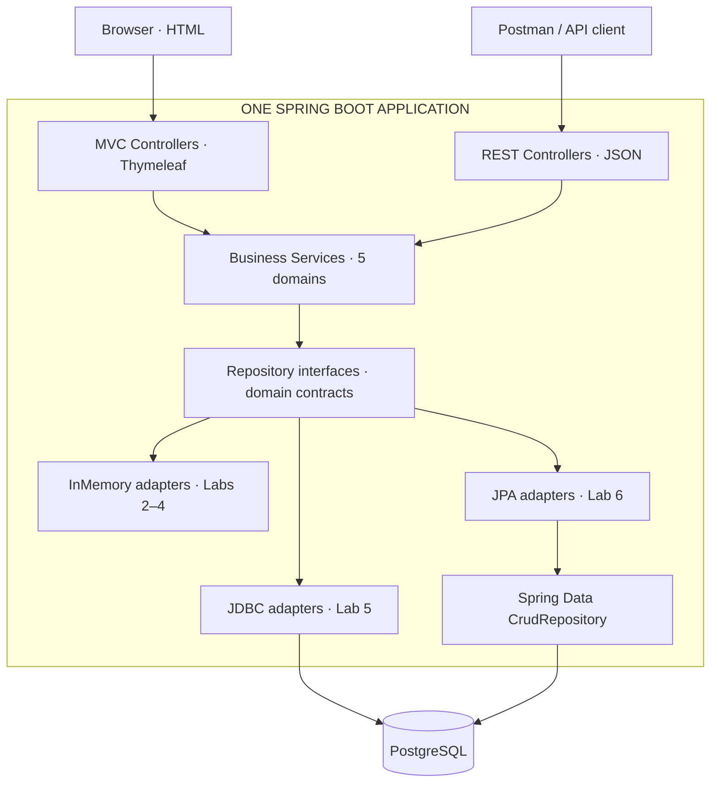
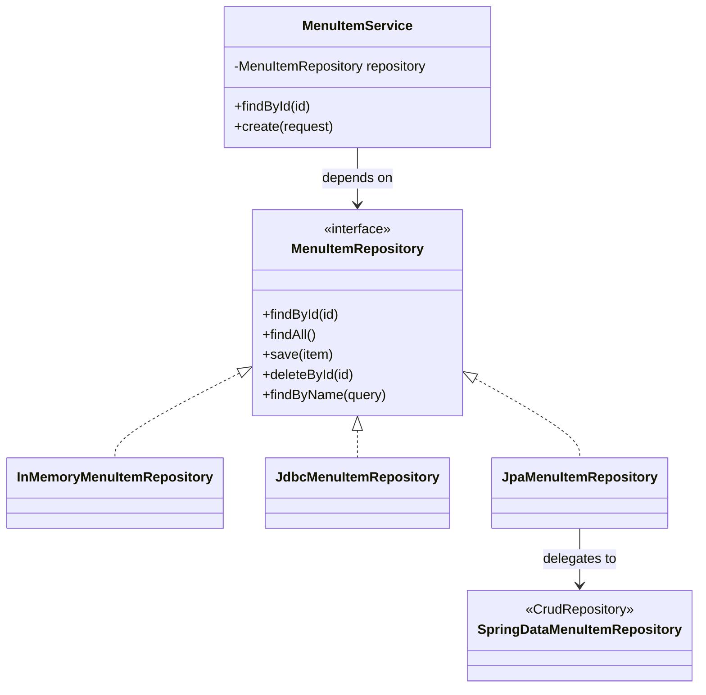
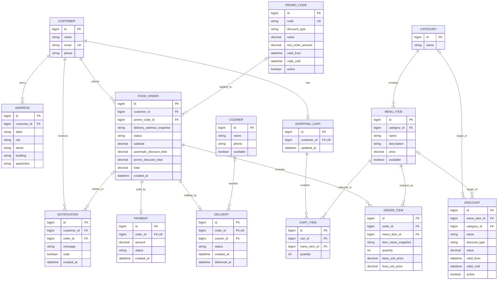
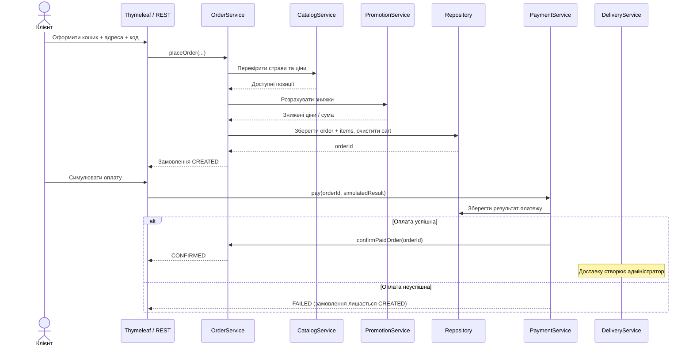

# 🐖 Peaky Porkers — The Blind Pig

> **System Design Document** · Food Ordering & Delivery · Spring Boot  
> **Статус:** фінальна проєктна версія для реалізації · **Версія:** 1.1 (team assignment) · **Дата:** 11.11.2026  
> **Архітектура:** Modular Monolith · **Команда:** 5 учасників (розподіл затверджено) · **Лабораторні:** №2–6

---

## 📑 Зміст

1. [Ідея та мета](#1-ідея-та-мета)
2. [Межі проєкту](#2-межі-проєкту)
3. [Архітектура та контракти репозиторіїв](#3-архітектура-та-контракти-репозиторіїв)
4. [П'ять бізнес-доменів](#4-пять-бізнес-доменів)
5. [ER-діаграма](#5-er-діаграма)
6. [Основні бізнес-сценарії](#6-основні-бізнес-сценарії)
7. [Правила ціноутворення та знижок](#7-правила-ціноутворення-та-знижок)
8. [REST API та Thymeleaf](#8-rest-api-та-thymeleaf)
9. [Структура проєкту](#9-структура-проєкту)
10. [Технології та інструменти](#10-технології-та-інструменти)
11. [План реалізації лабораторних](#11-план-реалізації-лабораторних)
12. [Взаємодія модулів і правила розробки](#12-взаємодія-модулів-і-правила-розробки)
13. [Тестування та критерії готовності](#13-тестування-та-критерії-готовності)
14. [Командний процес](#14-командний-процес)
15. [Відкриті рішення](#15-відкриті-рішення)

---

### Затверджений розподіл команди

| Домен / пакет | Відповідальний | Основні сутності |
|---|---|---|
| **Customer & Addresses** · `customer` | **Іван Федоренко (Іван)** | `Customer`, `Address` |
| **Catalog & Menu** · `catalog` | **Олександр Бондарчук (Саня)** | `Category`, `MenuItem` |
| **Shopping Cart & Orders** · `order` | **Данііл Марченко (Даня)** | `ShoppingCart`, `CartItem`, `FoodOrder`, `OrderItem` |
| **Payments & Promotions** · `billing` | **Максим Крамаренко (Супермакс)** | `Payment`, `PromoCode`, `Discount` |
| **Delivery & Notifications** · `delivery` | **Михайло Лобань (Міша)** | `Delivery`, `Courier`, `Notification` |

**Єдиний базовий Java package:** `ua.kpi.blindpig` — він уже існує у проєкті `BlindPig` (клас `ua.kpi.blindpig.BlindPigApplication`). Нові модулі додаємо *всередині* цього пакета; другий кореневий пакет не створюємо.

**Login для Customer** — лише можливе майбутнє доповнення. Наразі це керування профілями й адресами, **без обов'язкового Spring Security/JWT**.

---

## 1. Ідея та мета

**The Blind Pig** — навчальна система замовлення їжі з одного ресторану. Клієнт переглядає меню, керує кошиком, оформлює замовлення та відстежує його стан. Адміністратор керує каталогом, акціями, замовленнями, платежами й доставками.

**Peaky Porkers** — назва команди; **The Blind Pig** — назва застосунку/ресторану.

### Цілі

- Побудувати **один цілісний Spring Boot застосунок** для ЛР №2–6.
- Розділити роботу на **п'ять вертикальних доменів**, щоб кожен учасник розробляв свій функціонал від HTML до БД.
- Поступово змінювати технологію доступу до даних: **Fake Repository → JDBC → Spring Data JPA**.
- Продемонструвати Spring DI, MVC/Thymeleaf, REST, OpenAPI, транзакції та ORM.
- Зберегти зрозумілий код і не будувати інфраструктуру, якої не вимагають лабораторні.

> [!NOTE]
> У методичці до ЛР №2 тема **«Система замовлення їжі»** наведена як **варіант 14**. Документ виходить із того, що команді підходить саме цей варіант; його потрібно звірити з отриманим від викладача номером. Базові вимоги варіанта — меню, елементи меню, замовлення та їх оброблення. Інші домени — обрані командою навчальні розширення.

## 2. Межі проєкту

### У межах реалізації (MVP)

| Для клієнта | Для адміністратора / демонстрації |
|---|---|
| Перегляд категорій і страв | CRUD категорій і страв |
| Створення профілю та адрес | Перегляд клієнтів |
| Додавання/видалення страв у кошику | Перегляд і зміна статусу замовлень |
| Оформлення замовлення | CRUD акцій та промокодів |
| Автоматичні знижки та промокод | Імітація успішної/неуспішної оплати |
| Перегляд статусу замовлення | Керування кур'єрами та доставками |
| Перегляд повідомлень | Створення повідомлень про події |

### Свідомо **не** реалізуємо

Реальні банки / платіжні шлюзи, GPS-трекінг, карти й маршрути, мікросервіси, Kafka, Redis, React SPA, розгорнуту систему авторизації (JWT/OAuth2), промислову систему подій і повноцінний складський облік.

> [!IMPORTANT]
> **Мінімальна функціональність важливіша за кількість класів.** Для кожної ЛР спочатку реалізуємо те, що прямо перевіряється методичкою, і тільки після цього — факультативні можливості.

---

## 3. Архітектура та контракти репозиторіїв

### 3.1. Архітектурний стиль

**Modular Monolith:** один процес Spring Boot, один Maven-проєкт, одна PostgreSQL БД, п'ять пакетів-доменів. Модулі **не** є окремими сервісами і не викликають один одного через HTTP.



> **На схемі показані три послідовні етапи, а не три одночасно активні реалізації.** In-memory не підключається до PostgreSQL. У робочій версії поточної лабораторної для кожного контракту репозиторію існує **одна активна Spring-реалізація**.

> `Fake / JDBC / JPA` — **етапи еволюції**, а не три обов'язкові одночасні сховища. До ЛР №5 дані живуть у пам'яті, з ЛР №5 — у PostgreSQL.

### 3.2. Типовий вертикальний зріз

```text
Thymeleaf form  ──→ PageController ──┐
                                     ├──→ Service ──→ Repository ──→ Data
JSON request    ──→ RestController ──┘
```

- **Controller:** приймає HTTP-запит, робить валідацію DTO, віддає HTML або JSON.
- **Service:** бізнес-правила, операції над кількома сутностями, транзакції.
- **Repository:** збереження, CRUD, пошук; конкретний спосіб змінюється між лабораторними.
- **DTO:** окремі request/response-моделі для REST, щоб не повертати JPA `@Entity` напряму.

**Обов'язкова архітектурна домовленість:** кожен `Service` залежить від **власного інтерфейсу репозиторію свого домену**, а не від конкретного `InMemory...`, `Jdbc...` або `SpringData...` класу. Це особливо важливо для переходів між ЛР №2, №5 та №6. Інтерфейси потрібні для **репозиторіїв**; додаткові інтерфейси сервісів, контролерів і маперів створюємо лише тоді, коли їх вимагає методичка або вони мають практичну користь.


### 3.3. Принцип DIP: сервіс залежить від контракту



У **кожному домені** застосовується однаковий принцип. Наприклад, для Catalog контракт може бути таким:

```java
public interface MenuItemRepository {
    Optional<MenuItem> findById(Long id);
    List<MenuItem> findAll();
    MenuItem save(MenuItem item);
    void deleteById(Long id);
    List<MenuItem> findByNameContaining(String name);
}
```

`MenuItemService` отримує `MenuItemRepository` через **constructor injection**:

```java
@Service
public class MenuItemService {
    private final MenuItemRepository repository;

    public MenuItemService(MenuItemRepository repository) {
        this.repository = repository;
    }

    public MenuItem getById(Long id) {
        return repository.findById(id)
                .orElseThrow(() -> new ResourceNotFoundException("Menu item not found"));
    }
}
```

Код сервісу **не має** посилатися на `JdbcTemplate`, `JdbcClient`, `EntityManager`, `CrudRepository` чи `Map` із fake-сховища. Це деталі конкретного адаптера. Наведений код — зразок контракту, а не вимога однакових методів в усіх 14 репозиторіях: створюємо лише потрібні операції, водночас покриваючи CRUD і пошук для DAO у ЛР №5.

### 3.4. Які реалізації використовуємо на кожному етапі

| Етап | Адаптер контракту `MenuItemRepository` | Де дані | Що змінюється |
|---|---|---|---|
| ЛР №2–4 | `InMemoryMenuItemRepository` (`@Repository`) | `Map<Long, MenuItem>` | Реалізація зберігання, без БД |
| ЛР №5 | `JdbcMenuItemRepository` (`@Repository`) | PostgreSQL через `JdbcClient` або `JdbcTemplate` | SQL, мапінг рядків, generated ID |
| ЛР №6 | `JpaMenuItemRepository` (`@Repository`) | PostgreSQL через Spring Data JPA | JPA-сутності, ORM, `CrudRepository` |

**Критичне правило:** для одного інтерфейсу **не можна одночасно залишати три активні Spring-біни**, інакше constructor injection стане неоднозначним (`NoUniqueBeanDefinitionException`). Для вашого навчального проєкту найпростіше **замінювати попередній адаптер новим**, зберігаючи попередній стан у Git-тегах `lab-2` ... `lab-6`. Не потрібні ані фабрики репозиторіїв, ані складна система профілів.

У ЛР №6 Spring Data створює реалізацію інтерфейсу `CrudRepository`, але **він не є автоматично реалізацією вашого власного контракту**. Тому використовуємо тонкий адаптер:

```java
// Необхідні стандартні імпорти: Optional, List, StreamSupport.
// Spring Data інтерфейс для ЛР №6
public interface SpringDataMenuItemRepository
        extends CrudRepository<MenuItem, Long> {
    List<MenuItem> findByNameContainingIgnoreCase(String name);
}

// Адаптер власного контракту — і далі ін'єктується в Service
@Repository
public class JpaMenuItemRepository implements MenuItemRepository {
    private final SpringDataMenuItemRepository delegate;

    public JpaMenuItemRepository(SpringDataMenuItemRepository delegate) {
        this.delegate = delegate;
    }

    @Override
    public Optional<MenuItem> findById(Long id) {
        return delegate.findById(id);
    }

    @Override
    public List<MenuItem> findAll() {
        return StreamSupport.stream(delegate.findAll().spliterator(), false)
                .toList();
    }

    @Override
    public MenuItem save(MenuItem item) {
        return delegate.save(item);
    }

    @Override
    public void deleteById(Long id) {
        delegate.deleteById(id);
    }

    @Override
    public List<MenuItem> findByNameContaining(String name) {
        return delegate.findByNameContainingIgnoreCase(name);
    }
}
```

У цьому прикладі `MenuItem` стає `@Entity` **лише на етапі ЛР №6**. Щоб мінімізувати кількість класів, **не вводимо окрему persistence-entity й мапер для кожної моделі**, якщо немає реальної потреби. DTO для HTTP-запитів/відповідей залишаються окремими.

> [!IMPORTANT]
> Адаптер — невеликий міст між власним інтерфейсом і Spring Data. Він потрібен саме для того, щоб **не змінювати залежність сервісу при переході на JPA**, а не для створення «чистої архітектури» з десятком додаткових шарів.

### 3.5. Правила підміни та тестування

1. **Контракт стабільний:** операції та їхні значення (що відбувається, коли запис не знайдено, чи допускається порожній результат) узгоджуємо до ЛР №2.
2. **Одна активна реалізація:** під час міграції старий адаптер видаляємо або прибираємо його Spring-реєстрацію; не створюємо зайву конфігурацію `@Primary`, якщо вона не потрібна.
3. **Service не переписуємо:** він викликає методи контракту; змінюється лише шар доступу до даних і, за потреби, анотації моделей.
4. **Тести сервісу** працюють із fake/mock реалізацією `MenuItemRepository`; інтеграційні тести перевіряють JDBC/JPA на тестовій БД.
5. **Переходи поетапні:** після кожного етапу робимо Git tag, який зберігає повністю робочу версію проєкту.

**Висновок:** Repository interface — обов'язковий для кожного сховища, яке потрібно міняти між лабораторними. `Service` та обидва контролери не знають, яка реалізація активна.

---

## 4. П'ять бізнес-доменів

### 4.1. 👤 Customer & Addresses

**Відповідальний:** **Іван Федоренко (Іван)**

**Призначення:** дані клієнтів та адреси доставки. **Не** є модулем автентифікації.

**Сутності:** `Customer`, `Address`.

**Функціональність:**
- Створення, перегляд, редагування й видалення профілю клієнта.
- Додавання, редагування та видалення адрес.
- Перегляд усіх адрес конкретного клієнта, вибір адреси при оформленні.
- Пошук клієнтів за іменем/email.

**Головні правила:** email клієнта унікальний; адреса належить лише одному клієнту; замовлення зберігає **текстовий знімок адреси на момент оформлення**, щоб історія не змінювалась після редагування адреси.

**Thymeleaf:** список клієнтів, профіль, форма клієнта, список/форма адрес.  
**REST:** `/api/customers`, `/api/customers/{id}/addresses`.  
**JDBC / JPA:** CRUD і пошук; `Customer` → `Address` (1:N).

### 4.2. 🍕 Catalog & Menu

**Відповідальний:** **Олександр Бондарчук (Саня)**

**Призначення:** базовий каталог страв одного ресторану.

**Сутності:** `Category`, `MenuItem`.

**Функціональність:**
- CRUD категорій і страв.
- Список страв за категорією, пошук за назвою.
- Фільтрація за доступністю та діапазоном цін.
- Пагінація списку страв.
- Показ **базової** та **акційної** ціни (акційну ціну розраховує Promotions).

**Головні правила:** `price >= 0`; недоступну страву не можна додати до нового замовлення; Catalog **не зберігає** розмір поточної акції всередині `MenuItem`.

**Thymeleaf:** меню, сторінка страви, форми категорії/страви.  
**REST:** `/api/categories`, `/api/menu-items`.  
**JDBC / JPA:** CRUD, пошук, `Category` → `MenuItem` (1:N).

> У ЛР №4 саме **Catalog** може показати обидва стандарти `PATCH`: JSON Patch (RFC 6902) і JSON Merge Patch (RFC 7386). Цю вимогу не потрібно дублювати в кожному домені.

### 4.3. 🛒 Shopping Cart & Orders

**Відповідальний:** **Данііл Марченко (Даня)**

**Призначення:** кошик, оформлення та життєвий цикл замовлення.

**Сутності:** `ShoppingCart`, `CartItem`, `FoodOrder` (Java-клас можна назвати `Order`), `OrderItem`.

**Функціональність:**
- Один активний кошик на клієнта.
- Додавання страв, зміна кількості, видалення позицій, очищення кошика.
- Створення замовлення з кошика, перевірка наявності позицій і доступності страв.
- Розрахунок підсумкової суми з урахуванням даних Promotions.
- Перегляд історії, деталей та зміна допустимих статусів замовлення.

**Головні правила:** кількість позиції `> 0`; порожній кошик не оформлюється; в замовленні фіксуються **назва, базова ціна і фактична ціна кожної позиції** на момент покупки; оформлення замовлення та очищення кошика виконуються атомарно у транзакції в ЛР №5–6.

**Thymeleaf:** кошик, підтвердження замовлення, історія, деталі.  
**REST:** `/api/carts/{customerId}`, `/api/orders`.  
**JDBC / JPA:** операції над кількома таблицями, rollback, `FoodOrder` → `OrderItem` (1:N).

### 4.4. 💳 Payments & Promotions

**Відповідальний:** **Максим Крамаренко (Супермакс)**

**Призначення:** автоматичні знижки, промокоди та демонстраційні платежі.

**Сутності:** `Discount`, `PromoCode`, `Payment`.

**Функціональність:**
- CRUD автоматичних знижок **на страву або на категорію**.
- CRUD промокодів для знижки на все замовлення.
- Перевірка періоду дії, активності, коректності відсотка/суми.
- Розрахунок акційної ціни й вигоди для кошика.
- Створення платежу для замовлення; імітація результату `PAID` або `FAILED`.
- Перегляд і пошук платежів за статусом/замовленням.

**Головні правила:** одна автоматична знижка прив'язана **або** до `MenuItem`, **або** до `Category` (рівно одне посилання); одна найвигідніша автоматична знижка на позицію; промокод застосовується **після** автоматичних знижок; кінцева сума ніколи не стає від'ємною; один актуальний платіж на замовлення у спрощеному MVP.

**Thymeleaf:** акції, промокоди, список і деталі платежів.  
**REST:** `/api/discounts`, `/api/promo-codes`, `/api/payments`.  
**JDBC / JPA:** CRUD/пошук акцій і промокодів; пошук платежів.

### 4.5. 🚴 Delivery & Notifications

**Відповідальний:** **Михайло Лобань (Міша)**

**Призначення:** кур'єри, призначення доставки, її статус і повідомлення.

**Сутності:** `Courier`, `Delivery`, `Notification`.

**Функціональність:**
- CRUD кур'єрів, пошук доступних кур'єрів.
- Створення доставки для підтвердженого замовлення.
- Призначення кур'єра та зміна статусів доставки.
- Створення повідомлень клієнту після значущих подій.
- Перегляд повідомлень і позначення їх прочитаними.

**Головні правила:** у доставки може бути тільки один кур'єр одночасно; доставка посилається на одне замовлення; не можна позначити її доставленою до призначення кур'єра; повідомлення зберігається в БД, **відправка email / WebSocket не обов'язкова**.

**Thymeleaf:** кур'єри, доставки, повідомлення.  
**REST:** `/api/couriers`, `/api/deliveries`, `/api/notifications`.  
**JDBC / JPA:** CRUD/пошук кур'єрів, доставки й повідомлень; `Courier` → `Delivery` (1:N).

### Порівняння зон відповідальності

| Домен | Головна бізнес-операція | Що демонструвати на ЛР №5–6 |
|---|---|---|
| Customer (Іван) | Керування профілем і адресами | CRUD, пошук, зв'язок 1:N |
| Catalog (Саня) | Меню та доступність | CRUD, фільтри, pagination, JPQL |
| Shopping & Orders (Даня) | Checkout з кошика | Транзакція, rollback, зв'язки 1:N |
| Payments & Promotions (Супермакс) | Акції + імітована оплата | Складні критерії вибору активних знижок |
| Delivery & Notifications (Міша) | Призначення кур'єра та повідомлення | CRUD, пошук за статусом, зв'язки 1:N |

---

## 5. ER-діаграма

**Узгоджена модель: 14 сутностей у 5 доменах.** `CartItem` — окрема позиція кошика; `Discount` — окрема автоматична акція. Обидві сутності потрібні для узгодженої роботи сценаріїв.

> Позначення: `PK` — первинний ключ, `FK` — зовнішній ключ. Усі `id` — умовно `BIGINT` з генерацією БД від ЛР №5. У Java для грошових величин використовуємо `BigDecimal`, у PostgreSQL — `NUMERIC(12,2)`.



### 5.1. Ключові зв'язки й обмеження

| Зв'язок | Кардинальність | Коментар |
|---|---|---|
| Customer → Address | 1:N | Клієнт може мати декілька адрес |
| Customer → ShoppingCart | 1:0..1 | Не більше одного активного кошика |
| ShoppingCart → CartItem | 1:N | Одна страва — одна позиція кошика (`UNIQUE(cart_id, menu_item_id)`) |
| Category → MenuItem | 1:N | Кожна страва має одну категорію |
| FoodOrder → OrderItem | 1:N | Після оформлення замовлення має мінімум 1 позицію |
| MenuItem / Category → Discount | 1:N | Для конкретної акції заповнений рівно один target FK |
| PromoCode → FoodOrder | 1:N | У замовленні максимум один застосований промокод |
| FoodOrder → Payment | 1:0..1 | Один поточний демонстраційний платіж на замовлення |
| FoodOrder → Delivery | 1:0..1 | Доставка створюється після підтвердження |
| Courier → Delivery | 1:N | Доставка може ще не мати кур'єра |
| Customer → Notification | 1:N | Повідомлення належить клієнту; `order_id` необов'язковий |

**Обмеження, які варто забезпечити в БД та/або сервісах:**

- `CHECK (price >= 0)`, `CHECK (quantity > 0)`, `CHECK (total >= 0)`.
- `UNIQUE (customer.email)`, `UNIQUE (promo_code.code)`, `UNIQUE (shopping_cart.customer_id)`.
- `UNIQUE (cart_item.cart_id, cart_item.menu_item_id)` — не створювати дубль позиції.
- Для `discount`: `(menu_item_id IS NOT NULL) <> (category_id IS NOT NULL)`.
- `Discount.value` і `PromoCode.value`: для відсотка **0 < value ≤ 100**, для фіксованої знижки `value > 0`.
- `valid_until > valid_from` (якщо обидві дати задані).
- **Не видаляти історичні замовлення каскадно** при редагуванні каталогу чи профілю; збережені snapshots залишаються в історії.

> [!TIP]
> ER-діаграма — **цільова схема для ЛР №5–6**. У ЛР №2–4 ці самі моделі можуть бути звичайними Java-класами без JPA-анотацій та фізичних таблиць.

---

## 6. Основні бізнес-сценарії

### 6.1. Оформлення замовлення — наскрізний сценарій

1. Клієнт відкриває меню, вибирає страви й додає їх у кошик.
2. Система перевіряє `available`, кількість і базову ціну страв.
3. Promotions обчислює доступні автоматичні знижки, потім перевіряє необов'язковий промокод.
4. Клієнт обирає адресу й натискає «Оформити замовлення».
5. Order створює `FoodOrder` і `OrderItem` із зафіксованими цінами й адресою; очищає кошик.
6. Payment створює платіж `PENDING` і дозволяє змоделювати результат оплати.
7. Після `PAID` замовлення переходить у `CONFIRMED`.
8. Адміністратор створює доставку, призначає кур'єра та змінює її статус.
9. Notification зберігає повідомлення про важливі події; клієнт бачить їх на сторінці.



### 6.2. Статуси

| Об'єкт | Стани | Дозволені основні переходи |
|---|---|---|
| Order | `CREATED`, `CONFIRMED`, `COMPLETED`, `CANCELLED` | `CREATED → CONFIRMED/CANCELLED`; `CONFIRMED → COMPLETED/CANCELLED`* |
| Payment | `PENDING`, `PAID`, `FAILED` | `PENDING → PAID/FAILED` |
| Delivery | `CREATED`, `ASSIGNED`, `IN_TRANSIT`, `DELIVERED` | Послідовно `CREATED → ASSIGNED → IN_TRANSIT → DELIVERED` |

\* Для MVP скасування підтвердженого замовлення дозволяється лише **до початку доставки**. Повернення реальних коштів не моделюємо. `Order.COMPLETED` встановлюється після `Delivery.DELIVERED`.

**Не робимо універсальну state-machine бібліотеку.** Перевірки переходів у звичайних service-методах достатні.

### 6.3. Транзакційність

Головний приклад для ЛР №5–6 — `placeOrder()`:

```text
BEGIN
  validate cart and products
  insert food_order
  insert order_items (N rows)
  clear cart_items
COMMIT
```

Якщо будь-який крок завершився помилкою, виконується **ROLLBACK**: не повинно лишитися частково створеного замовлення чи очищеного кошика. Для демонстрації готуємо позитивний сценарій та навмисну помилку після першого запису.

---

## 7. Правила ціноутворення та знижок

### 7.1. Типи акцій

| Механізм | Де діє | Приклад |
|---|---|---|
| `Discount` на страву | Один `MenuItem` | −20% на піцу |
| `Discount` на категорію | Всі страви `Category` | −15% на суші |
| `PromoCode` | Весь кошик/замовлення | Код `WELCOME10`: −10% |

Для `Discount` і `PromoCode` підтримуємо `PERCENTAGE` (відсоток) та `FIXED` (сума в гривнях). Поля `active`, `valid_from`, `valid_until` задають період дії; промокод також може мати `min_order_amount`.

### 7.2. Прості та передбачувані правила

1. Для кожної страви знаходимо активні акції на **саму страву** та **її категорію**.
2. Обираємо **одну найвигіднішу** акцію, не сумуємо дві автоматичні знижки.
3. Отримуємо суму з урахуванням знижених цін позицій.
4. Якщо введено валідний промокод, застосовуємо його **один раз до суми кошика після автоматичних знижок**.
5. Для `FIXED` не допускаємо зменшення суми нижче нуля.
6. Округлення — до 2 знаків (`HALF_UP`), на рівні **ціни одиниці** після автоматичної знижки та **суми промокоду**.
7. Фіксуємо результат у `OrderItem` і `FoodOrder`; зміни акцій згодом не переписують історію.

### 7.3. Розрахунок — приклад

| Крок | Сума |
|---|---:|
| Піца, 1 шт. (базова ціна) | 300,00 грн |
| Автоматична знижка 20% | −60,00 грн |
| Сума після автоматичної акції | **240,00 грн** |
| Промокод `WELCOME10`, 10% | −24,00 грн |
| **До сплати** | **216,00 грн** |

**Формула:**

```text
itemFinalUnitPrice = max(0, baseUnitPrice - bestAutomaticDiscount)
subtotalAfterAuto  = sum(itemFinalUnitPrice * quantity)
promoDiscount      = validatedPromoDiscount(subtotalAfterAuto)
orderTotal         = max(0, subtotalAfterAuto - promoDiscount)
```

У `FoodOrder.subtotal` зберігаємо суму **без** знижок; `automatic_discount_total` і `promo_discount_total` — окремо; `total = subtotal - automatic_discount_total - promo_discount_total`.

> [!IMPORTANT]
> **Єдине джерело істини для ціни — сервер.** Клієнт може показувати попередній розрахунок, але під час checkout сервер перевіряє всі страви й акції та перераховує суму заново. Ціну з HTML-форми чи JSON не вважаємо довіреною.

---

## 8. REST API та Thymeleaf

### 8.1. Орієнтовні REST-ресурси

Базовий префікс: `/api`. Нижче — **проєктований мінімум**, не жорсткий список усіх майбутніх операцій.

| Домен | Ресурс | Типові операції |
|---|---|---|
| Customer | `/api/customers` | `GET`, `POST`, `GET /{id}`, `PUT /{id}`, `DELETE /{id}` |
| Customer | `/api/customers/{id}/addresses` | `GET`, `POST`; адреса за ID — `PUT`, `DELETE` |
| Catalog | `/api/categories` | CRUD |
| Catalog | `/api/menu-items` | CRUD, фільтри, пагінація, `PATCH` |
| Shopping & Orders | `/api/carts/{customerId}/items` | Додати позицію, змінити кількість, видалити |
| Shopping & Orders | `/api/orders` | Створити з кошика, список, деталі |
| Shopping & Orders | `/api/orders/{id}/status` | Змінити статус із перевіркою переходу |
| Payments & Promotions | `/api/discounts` | CRUD, пошук активних |
| Payments & Promotions | `/api/promo-codes` | CRUD, перевірка промокоду |
| Payments & Promotions | `/api/payments` | Створити/переглянути, симулювати результат |
| Delivery & Notifications | `/api/couriers` | CRUD, пошук вільних |
| Delivery & Notifications | `/api/deliveries` | Створити, призначити кур'єра, змінити статус |
| Delivery & Notifications | `/api/notifications` | Список, деталі, позначити прочитаним |

Приклад фільтрації й пагінації (Catalog):

```http
GET /api/menu-items?categoryId=2&available=true&page=0&size=10
```

Приклад двох форматів часткового оновлення **одного ресурсу** (ЛР №4):

```http
PATCH /api/menu-items/7
Content-Type: application/json-patch+json

[{"op":"replace","path":"/price","value":249.00}]
```

```http
PATCH /api/menu-items/7
Content-Type: application/merge-patch+json

{"available":false}
```

Обидва запити мають застосовувати зміни до дозволених полів DTO, проходити повторну валідацію й коректно повертати статуси помилок. Не дозволяємо patch полів на кшталт `id` та внутрішніх зв'язків без перевірок.

### 8.2. Правила REST

- `GET` — читання, `POST` — створення, `PUT` — повна зміна ресурсу, `PATCH` — часткова, `DELETE` — видалення.
- `201 Created` + `Location` після створення; `200 OK` для читання/оновлення; `204 No Content` після видалення без тіла.
- `400 Bad Request` — невалідний формат; `404 Not Found` — немає ресурсу; `409 Conflict` — конфлікт стану; інші коди — за потребою.
- Для input — `@Valid` та окремі request DTO; для output — response DTO.
- Глобальні помилки: `@RestControllerAdvice` / `@ExceptionHandler`, єдиний простий формат JSON.
- OpenAPI/Swagger UI документує призначення, параметри, request/response та можливі коди відповідей.
- Postman перевіряє happy path **і** кілька негативних сценаріїв.

### 8.3. Серверні HTML-сторінки

```text
/                   — головна / коротке меню
/menu               — меню та фільтри
/cart               — кошик
/orders             — історія замовлень
/customers          — керування клієнтами
/promotions         — акції й промокоди
/deliveries         — доставки
/notifications      — повідомлення
```

Для кожного домену достатньо **списку + форми + деталей**, де це має сенс. Використовуємо один спільний header/nav/footer, щоб не дублювати розмітку. 

**Thymeleaf для ЛР №3:** `th:each`, `th:if` / `th:unless` / Elvis, `th:switch` / `th:case`; для недовірених рядків — `th:text` (екранування), не `th:utext`.

> У ЛР №3 шаблонізатор призначається викладачем (Thymeleaf або JSP). Тут **обрано Thymeleaf**, як у вашому задумі, але вибір слід підтвердити.

---

## 9. Структура проєкту

Пакети організовані **за доменами**, всередині кожного — свої контролери, сервіси, репозиторії та DTO. **Проєкт уже створено** в IntelliJ як `BlindPig`: залишаємо наявний `pom.xml`, Maven Wrapper та `ua.kpi.blindpig.BlindPigApplication`, а не генеруємо новий застосунок.

```text
BlindPig/
├── .mvn/
├── mvnw
├── mvnw.cmd
├── pom.xml
├── README.md
├── docs/
│   ├── DESIGN.md                    # архітектура та доменні контракти
│   ├── LAB_PLAN.md                  # специфіка лабораторних
│   └── SERVICE_CONTRACTS.md         # сигнатури сервісів і DTO
├── .gitignore
├── compose.yaml                     # PostgreSQL, коли дійдемо до ЛР №5
├── src/
│   ├── main/
│   │   ├── java/ua/kpi/blindpig/
│   │   │   ├── BlindPigApplication.java  # існує в проєкті
│   │   │   ├── customer/
│   │   │   │   ├── model/
│   │   │   │   ├── repository/
│   │   │   │   ├── service/
│   │   │   │   ├── web/
│   │   │   │   └── dto/
│   │   │   ├── catalog/
│   │   │   │   ├── model/            # MenuItem, Category
│   │   │   │   ├── repository/       # MenuItemRepository (контракт)
│   │   │   │   │   ├── InMemoryMenuItemRepository.java  # ЛР №2–4
│   │   │   │   │   ├── JdbcMenuItemRepository.java      # ЛР №5
│   │   │   │   │   └── JpaMenuItemRepository.java       # ЛР №6
│   │   │   │   ├── service/
│   │   │   │   ├── web/              # PageController + RestController
│   │   │   │   └── dto/
│   │   │   ├── order/
│   │   │   ├── billing/              # payments + promotions
│   │   │   ├── delivery/             # delivery + notifications
│   │   │   ├── common/               # лише справді спільні речі
│   │   │   └── config/
│   │   └── resources/
│   │       ├── application.yml
│   │       ├── templates/
│   │       │   ├── fragments/
│   │       │   ├── customer/
│   │       │   ├── catalog/
│   │       │   ├── order/
│   │       │   ├── billing/
│   │       │   └── delivery/
│   │       └── static/css/
│   └── test/java/ua/kpi/blindpig/
└── postman/                           # експорт тестових запитів (за потреби)
```

> На старті **не створюємо порожні класи й пакети наперед**. Три наведені реалізації Catalog — **приклад еволюції**, не три файли, які потрібно тримати активними одночасно. У ЛР №6 поруч із `JpaMenuItemRepository` додається `SpringDataMenuItemRepository extends CrudRepository<...>`. Один `pom.xml`, без multi-module Maven.

У межах домену `web` може містити `PageController` (Thymeleaf) та `RestController` (JSON). Обидва викликають той самий `Service`.

---

## 10. Технології та інструменти

| Категорія | Рішення | Навіщо |
|---|---|---|
| Мова | Java 21 LTS *(або Java 17 за домовленістю команди)* | Єдина версія JDK для всіх |
| Framework | Spring Boot | DI, MVC, REST, JDBC, JPA |
| Build | Maven | Одна конфігурація збірки |
| HTML | Thymeleaf + звичайний CSS | ЛР №3, без JS-фреймворку |
| Validation | Jakarta Bean Validation | Валідація введення |
| REST docs | OpenAPI / Swagger UI (springdoc) | ЛР №4–6 |
| API testing | Postman | Перевірка HTTP-сценаріїв |
| DB | PostgreSQL | ЛР №5–6 |
| DB access (ЛР №5) | `JdbcTemplate`, `JdbcClient` | Ручні SQL-запити |
| ORM (ЛР №6) | Spring Data JPA + Hibernate | `@Entity`, `CrudRepository`, JPQL |
| Testing | JUnit + Spring Test + Mockito за потреби | Ключова логіка і транзакції |
| VCS | Git + GitHub | Спільна розробка, PR, теги |
| DB runtime | Docker Compose **або** локальний PostgreSQL | Обрати один найзручніший спосіб |

**Залежності додаємо поетапно**, а не всі в першому коміті. Конкретні версії Spring Boot та springdoc команда узгоджує при створенні `pom.xml` з перевіркою сумісності.

---

## 11. План реалізації лабораторних

| Етап | Що впроваджуємо | Критерій готовності |
|---|---|---|
| **ЛР №2 — Spring Components** | Контракти Repository + `@Repository` fake, `@Service`, `@Controller`, `@Bean`, singleton/prototype, constructor/setter/field injection | Робоча базова логіка; окрема демонстрація всіх видів DI |
| **ЛР №3 — Templates** | Thymeleaf, форми, умовне форматування, `switch/case`, цикли, XSS escaping | У браузері можна виконати ключовий сценарій без REST-клієнта |
| **ЛР №4 — REST** | REST CRUD, фільтрація, пагінація, RFC 6902 + RFC 7386, HTTP status, OpenAPI | Swagger документація + Postman-перевірки |
| **ЛР №5 — JDBC** | PostgreSQL, SQL-схема та дані, JDBC-адаптери власних контрактів через `JdbcTemplate` + `JdbcClient`, CRUD + пошук у DAO, `@Transactional` | Дані зберігаються; create повертає згенерований ID; rollback працює |
| **ЛР №6 — Spring Data** | `@Entity`, `CrudRepository` + адаптер контракту, `@Query` (JPQL), `@NamedQuery`, derived query, 1:N, транзакція | API працює на JPA; три типи пошуку й rollback продемонстровані |

### 11.1. Що робить **кожен** учасник

| Етап | Персональний результат у своєму домені |
|---|---|
| №2 | Модель, інтерфейс Repository, fake-реалізація, service, мінімальний page controller |
| №3 | Власні Thymeleaf-сторінки, форми, взаємодія із сервісом |
| №4 | REST-ендпоінти, DTO, OpenAPI-описи, тести запитів |
| №5 | JDBC-адаптер власного Repository-контракту та SQL для власних таблиць |
| №6 | JPA Entity, `CrudRepository` та адаптер власного контракту, пошук для своїх сутностей |

> **Вимоги методичок діють до всього застосунку**, не зобов'язують п'ятикратно дублювати кожен спеціальний механізм. Наприклад, два формати PATCH достатньо показати на одному ресурсі; `@NamedQuery`, JPQL `@Query` і derived query — на різних доменах. Водночас кожен матиме власні HTML, REST, JDBC і JPA-частини.

### 11.2. Перехід від JDBC до JPA

**Не підтримуємо одночасно дві повні реалізації сховища, якщо викладач не вимагає іншого.**

```text
MenuItemService → MenuItemRepository (НЕ ЗМІНЮЄТЬСЯ)
                         │
ЛР №2–4          InMemoryMenuItemRepository
                         ↓  tag: lab-4
ЛР №5            JdbcMenuItemRepository  → PostgreSQL
                         ↓  tag: lab-5
ЛР №6            JpaMenuItemRepository   → Spring Data CrudRepository → PostgreSQL
```

Після завершення кожної лабораторної створюємо Git tag (`lab-2` … `lab-6`). У ЛР №6 JPA-моделі можуть отримати `@Entity`, `@Id`, `@OneToMany` тощо, однак **публічні методи Repository-контракту й залежності Service залишаються стабільними**. Якщо виникає потреба у JPA-специфічному пошуку, реалізуємо його всередині адаптера, зберігаючи назовні доменну сигнатуру.

---

## 12. Взаємодія модулів і правила розробки

### 12.1. Правила меж доменів

1. **Кожен домен володіє своїми сутностями й власними Repository-контрактами.** Інші домени не повинні напряму редагувати його таблиці.
2. Модулі викликають **публічні service-методи** інших модулів, а не чужі репозиторії. Усередині домену Service залежить лише від свого Repository-інтерфейсу.
3. Між доменами передаємо **ID, запити та прості DTO**, без великих взаємозалежних графів JPA-об'єктів.
4. `OrderService` запитує Catalog щодо доступності/ціни, а Promotions — щодо правил знижки.
5. `PaymentService` керує статусом платежу; після успішної оплати викликає чітко визначену операцію підтвердження замовлення.
6. Delivery та Notifications читають лише потрібні дані замовлення/клієнта через сервіси.
7. Spring Events можна використати для **другорядних повідомлень**. Для критичного оформлення замовлення не покладаємось на ненадійне фонове виконання.
8. **Уникаємо циклів ін'єкції Spring-бінів.** Наприклад, `OrderService` не залежить від `PaymentService`, якщо `PaymentService` вже викликає його метод підтвердження.

### 12.2. Контракти, які потрібно узгодити до паралельної роботи

| Хто надає | Мінімальний контракт | Хто використовує |
|---|---|---|
| Customer | `getCustomer(id)`, `getAddress(customerId, addressId)` | Orders |
| Catalog | `getPurchasableItem(id)` → назва, базова ціна, категорія, доступність | Cart, Orders, Promotions |
| Promotions | `calculatePrice(menuItemId, categoryId, basePrice)`; `applyPromo(code, amount)` | Orders, UI |
| Orders | `getOrder(id)`, `confirmPaidOrder(id)`, `completeDeliveredOrder(id)` | Payments, Delivery |
| Payments | `simulatePayment(orderId, result)` | UI / REST |
| Delivery | `assignCourier(deliveryId, courierId)`, `changeStatus(...)` | UI / REST |
| Notifications | `createNotification(customerId, orderId, message)` | Payments, Delivery або події |

Це **приклади сигнатур**, не обов'язково буквальні Java-інтерфейси. Фіксуємо зміст контрактів і узгоджені DTO; внутрішню реалізацію кожен учасник обирає сам.

### 12.3. Практичні домовленості

- Імена Java-класів англійською, однакові правила форматування; `CustomerService`, а не `CustomerManagerImplFactory`.
- Використовуємо constructor injection за замовчуванням; setter/field injection показуємо **окремо** для вимог ЛР №2.
- **Інтерфейс Repository — стабільна точка підміни** InMemory → JDBC → JPA; в Spring Data доступ іде через тонкий адаптер. Не ін'єктуємо `CrudRepository` безпосередньо в бізнес-сервіси.
- Для грошей — `BigDecimal`, для статусів — `enum`, для ідентифікаторів — `Long`.
- Не робимо `cascade = ALL` між усіма JPA-сутностями за замовчуванням.
- Весь код, що змінює кілька пов'язаних записів, проходить через один service-метод із правильною транзакційною межею.
- Спільні стилі й фрагменти HTML — в одному місці; кожен домен наповнює власні шаблони.

---

## 13. Тестування та критерії готовності

### Мінімальний набір сценаріїв

- **Customer:** створити клієнта, додати адресу, спробувати дубль email.
- **Catalog:** CRUD страви, фільтрація й пагінація, JSON Patch і Merge Patch, заборона від'ємної ціни.
- **Orders:** додати 2 різні страви, змінити кількість, оформити; спробувати оформити порожній кошик.
- **Promotions:** знижка на страву; знижка на категорію; вибір найвигіднішої; неактивний промокод; перевірка ціни 300 → 240 → 216.
- **Payments:** успіх і відмова; не можна двічі провести вже успішний платіж.
- **Delivery:** призначення кур'єра, валідні/невалідні переходи статусів, поява повідомлення.
- **Transactions:** позитивний checkout і rollback після контрольованої помилки.
- **Database:** перезапуск застосунку не знищує дані на етапах JDBC/JPA.

### Definition of Done для кожної ЛР

- [ ] Застосунок збирається та запускається з чистого клонування за README.
- [ ] Усі обов'язкові пункти **поточної** методички продемонстровані.
- [ ] Нові доменні функції працюють через HTML та/або REST відповідно до етапу.
- [ ] Є тести бізнес-логіки та перевірки критичних негативних сценаріїв.
- [ ] Для REST є актуальна OpenAPI-документація та Postman-сценарії.
- [ ] Команда зробила одне узгоджене інтеграційне проходження основного сценарію.
- [ ] Створено Git tag відповідної лабораторної.

---

## 14. Командний процес

### Власники доменів

Розподіл **затверджено**; назви пакетів — `customer`, `catalog`, `order`, `billing`, `delivery`.

| № | Домен | Відповідальний | Гілка (приклад) |
|---|---|---|---|
| 1 | Customer & Addresses | **Іван Федоренко (Іван)** | `feature/customer-*` |
| 2 | Catalog & Menu | **Олександр Бондарчук (Саня)** | `feature/catalog-*` |
| 3 | Shopping Cart & Orders | **Данііл Марченко (Даня)** | `feature/order-*` |
| 4 | Payments & Promotions | **Максим Крамаренко (Супермакс)** | `feature/billing-*` |
| 5 | Delivery & Notifications | **Михайло Лобань (Міша)** | `feature/delivery-*` |

### Робочий цикл

1. Використовуємо вже створений `BlindPig` і його `main` як базу; додаємо README та погоджені контракти.
2. Кожен працює переважно у своєму пакеті, окремо створює невеликі feature branches.
3. Відкриваємо Pull Request, перевіряємо запуск/тести та узгодженість API.
4. Не змінюємо самостійно чужі моделі та спільні конфіги без узгодження.
5. Після інтеграції й демонстрації ставимо tag відповідної лабораторної.

**Не потрібні:** п'ять окремих репозиторіїв, постійні гілки на весь семестр, складні GitFlow-процеси, окремі CI/CD-пайплайни для кожного модуля.

---

## 15. Відкриті рішення

Перед реалізацією зафіксувати в команді:

- [ ] Підтвердити **номер варіанта** та **Thymeleaf** у викладача.
- [ ] Вибрати єдину версію JDK і сумісні версії Spring Boot / springdoc.
- [ ] Узгодити точні поля DTO, адреси й `FoodOrder`.
- [ ] Затвердити правила знижок (одна найвигідніша + один промокод) та округлення.
- [ ] Узгодити мінімальні методи Repository-інтерфейсів і семантику «не знайдено» перед паралельною роботою.
- [ ] Вирішити, чи `Payment.FAILED` дозволяє повторну спробу через скидання в `PENDING` (для MVP можна дозволити окремою командою `retry`).
- [ ] Визначити, що відбувається при видаленні клієнта/страви, які вже використані в історичних замовленнях (рекомендація: заборонити фізичне видалення або деактивувати).
- [ ] Підтвердити горизонтальні координаторські задачі з `LAB_PLAN.md` (layout, SQL-схема, помилки) без зміни власників доменів.

---

### ✅ Архітектурне рішення в одному абзаці

**The Blind Pig** — один модульний Spring Boot моноліт із п'ятьма вертикальними доменами та єдиною PostgreSQL БД (від ЛР №5). Кожен учасник реалізує власні сутності, Repository-інтерфейси, сервіси, Thymeleaf-сторінки, REST API, JDBC і JPA. **Сервіс залежить від власного контракту Repository, а не від технології БД**; реалізація підмінюється між лабораторними, а попередні етапи зберігаються Git-тегами. Принцип команди: **усі обов'язкові вимоги — так; зайва інфраструктура та дублювання — ні.**
