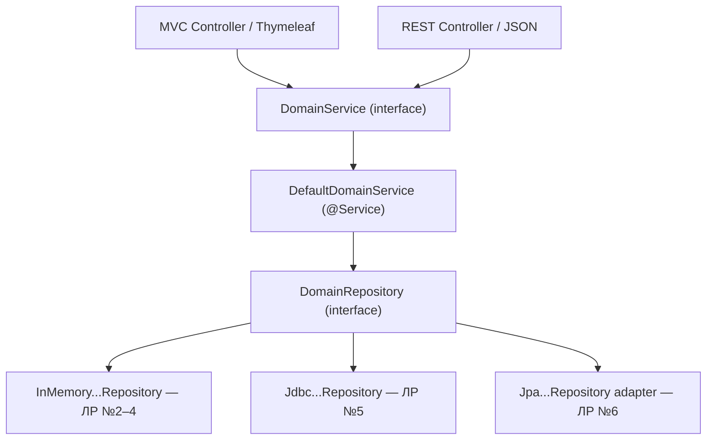
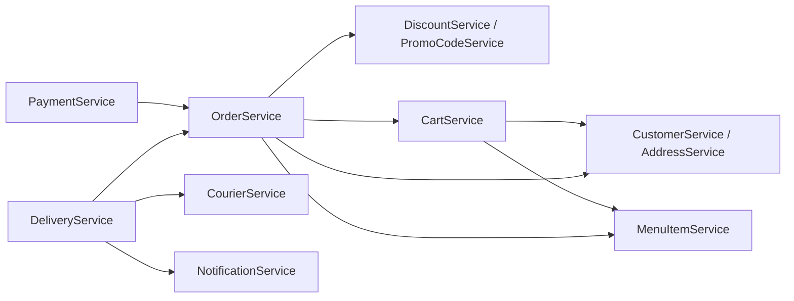
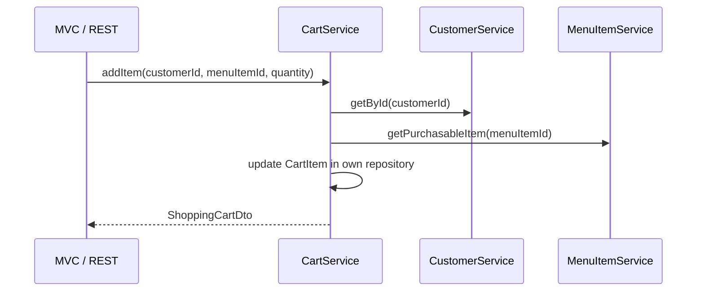
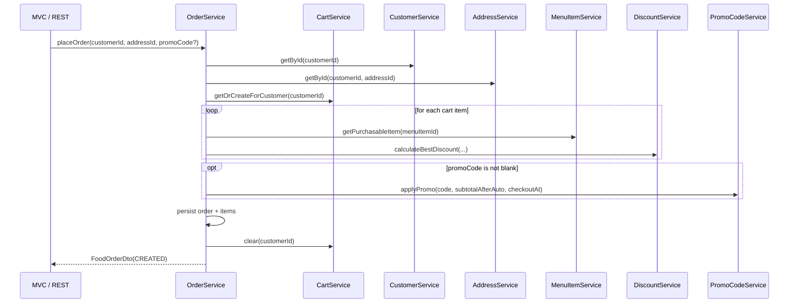
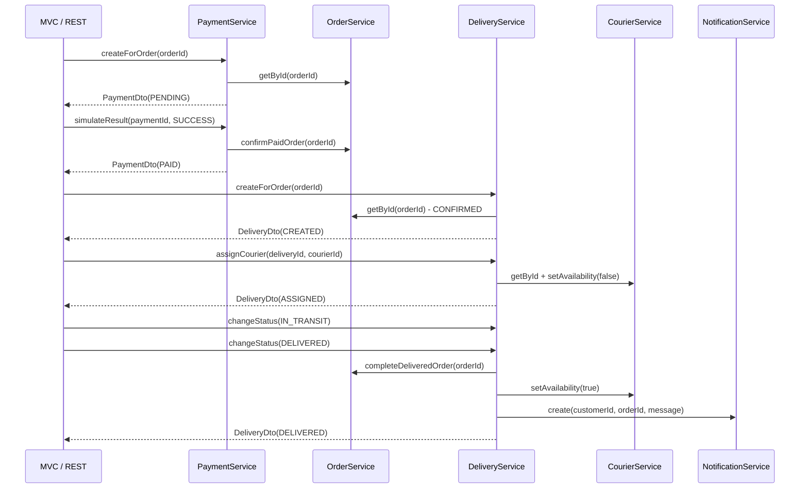

# 🐖 The Blind Pig — Service Contracts & DTO Specification

> **Peaky Porkers · Contract-first development · v2.0 · 11.11.2026**  
> **Проєкт:** `BlindPig` · **Java package:** `ua.kpi.blindpig` · **Мета:** узгодити публічні контракти **до** паралельної реалізації.  
> **Пов'язані документи:** [DESIGN.md](DESIGN.md)

> [!IMPORTANT]
> Це **єдине джерело істини для сигнатур сервісів, DTO, enum, спільних винятків і семантики викликів**. У цьому документі наведені **всі 12 сервісних інтерфейсів, усі 30 DTO/enum/спільних типів (із точними Java-оголошеннями) та 3 винятки**. Код збігається з узгодженим скелетом `service-contracts-skeleton.zip`. Сервіси, контролери, репозиторії й сутності команда реалізує самостійно. Не потрібно реалізовувати повну систему до ЛР №2.

## 0. Команда та відповідальність

| Домен | Пакет | Відповідальний | Сервісні контракти |
|---|---|---|---|
| Customer & Addresses | `customer` | **Іван Федоренко (Іван)** | `CustomerService`, `AddressService` |
| Catalog & Menu | `catalog` | **Олександр Бондарчук (Саня)** | `CategoryService`, `MenuItemService` |
| Shopping Cart & Orders | `order` | **Данііл Марченко (Даня)** | `CartService`, `OrderService` |
| Payments & Promotions | `billing` | **Максим Крамаренко (Супермакс)** | `DiscountService`, `PromoCodeService`, `PaymentService` |
| Delivery & Notifications | `delivery` | **Михайло Лобань (Міша)** | `CourierService`, `DeliveryService`, `NotificationService` |

**Назви сутностей:** `Customer`, `Address`, `Category`, `MenuItem`, `ShoppingCart`, `CartItem`, `FoodOrder`, `OrderItem`, `Discount`, `PromoCode`, `Payment`, `Courier`, `Delivery`, `Notification` (**14**). У сервісних контрактах вони представлені DTO; **не передаємо JPA Entity з одного домену в інший**. Окремі сервіси для `CartItem` та `OrderItem` не створюємо.

## Зміст

1. [Правила контрактів та структура](#1-правила-контрактів-та-структура)
2. [Залежності між доменами](#2-залежності-між-доменами)
3. [Сервісні інтерфейси — всі 12](#3-сервісні-інтерфейси--всі-12)
4. [DTO, Request, enum — повні оголошення](#4-dto-request-enum--повні-оголошення)
5. [Спільні типи та помилки](#5-спільні-типи-та-помилки)
6. [Бізнес-правила й інваріанти](#6-бізнес-правила-й-інваріанти)
7. [Контрактні сценарії інтеграції](#7-контрактні-сценарії-інтеграції)
8. [Як працювати паралельно з порожнього проєкту](#8-як-працювати-паралельно-з-порожнього-проєкту)
9. [Що відноситься до лабораторних №2–6](#9-що-відноситься-до-лабораторних-26)
10. [Definition of Done / перевірки](#10-definition-of-done--перевірки)

---

## 1. Правила контрактів та структура

### 1.1. Що робимо зараз (спільний стартовий PR)

- Створюємо **Java `interface`** для кожного з 12 публічних сервісів.
- Створюємо **Java `record` для DTO і вхідних Request**, а також enum статусів і типів знижок.
- Створюємо **3 спільні runtime-винятки** та `PageResult<T>`.
- Домовляємося, які методи хто викликає, що вони повертають і які помилки кидають.
- **Не створюємо одразу** `Controller`, `@Entity`, таблиці, `ServiceImpl`, `RepositoryImpl` чи Mock-реалізації «про запас». Їх додають власники доменів по лабораторних.

### 1.2. Головні домовленості

| Правило | Угода |
|---|---|
| Базовий package | `ua.kpi.blindpig` (не створювати `com....`) |
| ID усіх сутностей | `Long`; ID генерує репозиторій / БД, клієнт не призначає |
| Сервісні інтерфейси | `ua.kpi.blindpig.<domain>.service` |
| DTO, Request, enum | `ua.kpi.blindpig.<domain>.dto` |
| Спільні типи / помилки | `ua.kpi.blindpig.common` |
| Гроші | `BigDecimal`, гривні, scale 2, `RoundingMode.HALF_UP` для результатів розрахунків |
| Дати | `LocalDateTime` на MVP; одна timezone конфігурація сервера / БД |
| Відповідь сервісу | DTO, `List<DTO>`, `PageResult<DTO>` або `void`; **не JPA Entity** |
| Порожній список | `List.of()` / порожня сторінка; **ніколи `null`** |
| Неіснуючий ресурс | `ResourceNotFoundException` (404 в REST) |
| Некоректний ввід | `InvalidRequestException` (400 в REST) |
| Конфлікт стану / бізнес-правила | `BusinessConflictException` (409 в REST) |
| Ін'єкція залежностей | Constructor injection; одна реальна Spring-реалізація сервісу на момент запуску |
| Міждоменний доступ | Через **сервісний інтерфейс**, **не чужий `Repository`** |
| Власні репозиторії | `XRepository`-інтерфейс у домені; `InMemory → JDBC → JPA` за лабораторними |
| Авторизація | Не є частиною стартового контракту; login/JWT опціональні пізніше |

### 1.3. Сервіси та репозиторії — різні рівні контрактів



> **Пояснення:** на діаграмі три реалізації репозиторію — **альтернативи**, а не три активні біни одночасно. Сервісний інтерфейс фіксує API для інших людей; репозиторний інтерфейс полегшує підміну сховища. `@Service` реалізує інтерфейс; `@Repository` реалізує репозиторний контракт. **Немає потреби створювати `interface` для кожного внутрішнього helper-класу.**

### 1.4. Куди класти файли

```text
BlindPig/
├── docs/
│   ├── DESIGN.md
│   ├── LAB_PLAN.md
│   └── SERVICE_CONTRACTS.md
└── src/main/java/ua/kpi/blindpig/
    ├── BlindPigApplication.java
    ├── common/       # PageResult + 3 exception
    ├── customer/     # dto/ + service/ (Іван)
    ├── catalog/      # dto/ + service/ (Саня)
    ├── order/        # dto/ + service/ (Даня)
    ├── billing/      # dto/ + service/ (Супермакс)
    └── delivery/     # dto/ + service/ (Міша)
```

Після першого PR кожен додає до **свого пакета** `model/`, `repository/`, `web/`, `service/impl/` лише за потреби. Не кладіть усі DTO до глобального `common/dto`.

---

## 2. Залежності між доменами



Стрілка `A → B` означає: **реалізація A викликає публічний контракт B**. Циклів немає. Payment та Delivery використовують **уже створені** замовлення; `OrderService.placeOrder()` **не** викликає `PaymentService` чи `DeliveryService`.

| Публічний контракт | Використовують | Для чого |
|---|---|---|
| `CustomerService.getById` | Cart, Order | Перевірка існування клієнта |
| `AddressService.getById` | Order | Перевірка адреси, що належить клієнту |
| `MenuItemService.getPurchasableItem` | Cart, Order | Ціна, категорія, доступність |
| `CartService.getOrCreateForCustomer`, `clear` | Order | Оформлення з кошика та очищення |
| `DiscountService.calculateBestDiscount` | Order, перегляд каталогу | Найвигідніша автоматична знижка на позицію |
| `PromoCodeService.applyPromo` | Order | Необов'язковий промокод на чек |
| `OrderService.getById`, `confirmPaidOrder`, `completeDeliveredOrder` | Payment, Delivery | Сума/стан замовлення та завершення етапів |
| `CourierService.getById`, `setAvailability` | Delivery | Призначення/звільнення кур'єра |
| `NotificationService.create` | Delivery | Створення in-app сповіщення |

**Важливо для паралельної роботи:** після merge цього документа/Java-скелета кожен має **компіляційний контракт** чужого сервісу. У **unit-тестах** його можна замінити Mockito-моком. Для **звичайного старту всього Spring Boot** потрібна хоча б одна bean-реалізація кожного ін'єктованого сервісу (реальна або тимчасова stub). **Інтерфейс сам по собі не є Spring-bean.**

---

## 3. Сервісні інтерфейси — всі 12

Кожен блок нижче — **вміст окремого `.java` файлу**, який можна скопіювати до вказаного шляху. Вони не залежать від Spring. Коментарі після них фіксують семантику.

### 3.1. Customer & Addresses — Іван

#### `CustomerService.java`

**Шлях:** `src/main/java/ua/kpi/blindpig/customer/service/CustomerService.java`

```java
package ua.kpi.blindpig.customer.service;

import ua.kpi.blindpig.customer.dto.*;
import java.util.List;

public interface CustomerService {
    /** Unique email; duplicate -> BusinessConflictException. */
    CustomerDto create(SaveCustomerRequest request);
    CustomerDto getById(Long customerId);
    List<CustomerDto> list();
    List<CustomerDto> search(String nameOrEmail);
    CustomerDto update(Long customerId, SaveCustomerRequest request);
    void delete(Long customerId);
}
```

**Поведінка:** `create` перевіряє унікальність email (дубль → 409); `getById` / `update` / `delete` для невідомого ID → 404; `search` фільтрує за іменем або email і може повернути порожній список. Забороняємо видаляти клієнта, якщо потрібно зберегти пов’язані замовлення (409); історія замовлень не видаляється каскадно.

#### `AddressService.java`

**Шлях:** `src/main/java/ua/kpi/blindpig/customer/service/AddressService.java`

```java
package ua.kpi.blindpig.customer.service;

import ua.kpi.blindpig.customer.dto.*;
import java.util.List;

public interface AddressService {
    AddressDto create(Long customerId, SaveAddressRequest request);
    /** Both customerId and addressId must match; otherwise 404. */
    AddressDto getById(Long customerId, Long addressId);
    List<AddressDto> listForCustomer(Long customerId);
    AddressDto update(Long customerId, Long addressId, SaveAddressRequest request);
    void delete(Long customerId, Long addressId);
}
```

**Поведінка:** перед створенням адреси перевіряємо клієнта; `getById(customerId,addressId)` / `update` / `delete` шукають адресу **в межах конкретного клієнта**. Чужа адреса = 404. Не видаляємо історію замовлень: `FoodOrder` зберігає snapshot адреси.

### 3.2. Catalog & Menu — Саня

#### `CategoryService.java`

**Шлях:** `src/main/java/ua/kpi/blindpig/catalog/service/CategoryService.java`

```java
package ua.kpi.blindpig.catalog.service;

import ua.kpi.blindpig.catalog.dto.*;
import java.util.List;

public interface CategoryService {
    CategoryDto create(SaveCategoryRequest request);
    CategoryDto getById(Long categoryId);
    List<CategoryDto> list();
    CategoryDto update(Long categoryId, SaveCategoryRequest request);
    /** Deletion with linked menu items is rejected (409). */
    void delete(Long categoryId);
}
```

**Поведінка:** категорія з пов’язаними стравами не видаляється автоматично (409). `list()` повертає список, навіть якщо він порожній.

#### `MenuItemService.java`

**Шлях:** `src/main/java/ua/kpi/blindpig/catalog/service/MenuItemService.java`

```java
package ua.kpi.blindpig.catalog.service;

import ua.kpi.blindpig.catalog.dto.*;
import ua.kpi.blindpig.common.PageResult;

public interface MenuItemService {
    MenuItemDto create(SaveMenuItemRequest request);
    MenuItemDto getById(Long menuItemId);
    /** Same DTO; an unavailable item is rejected (409). */
    MenuItemDto getPurchasableItem(Long menuItemId);
    PageResult<MenuItemDto> search(MenuItemSearchCriteria criteria);
    MenuItemDto update(Long menuItemId, SaveMenuItemRequest request);
    /** JSON Patch and Merge Patch are applied/validated at web layer, then call update(). */
    void delete(Long menuItemId);
}
```

**Поведінка:** `getById` — показати будь-яку наявну страву; `getPurchasableItem` — **та сама DTO-структура**, але `available=false` → 409. `search` — фільтри і сторінки. `update` замінює повні дані. **RFC 6902 JSON Patch і RFC 7386 JSON Merge Patch обробляють REST-контролери:** читають поточний ресурс, застосовують patch, перевіряють фінальний `SaveMenuItemRequest` та викликають `update`. Немає потреби дублювати методи `patch...` у сервісі. Якщо страва використовується історичними замовленнями, фізичне видалення може бути заборонене (409); простіший варіант — `available=false`.

### 3.3. Shopping Cart & Orders — Даня

#### `CartService.java`

**Шлях:** `src/main/java/ua/kpi/blindpig/order/service/CartService.java`

```java
package ua.kpi.blindpig.order.service;

import ua.kpi.blindpig.order.dto.*;

public interface CartService {
    /** One active cart per customer; creates empty cart if absent. */
    ShoppingCartDto getOrCreateForCustomer(Long customerId);
    ShoppingCartDto addItem(Long customerId, Long menuItemId, int quantity);
    ShoppingCartDto changeQuantity(Long customerId, Long menuItemId, int quantity);
    ShoppingCartDto removeItem(Long customerId, Long menuItemId);
    void clear(Long customerId);
}
```

**Поведінка:** один кошик на одного клієнта; `addItem` додає кількість до наявної позиції, а не створює дубль; `changeQuantity` ставить **нову** кількість; обидва методи вимагають `quantity > 0`. Для видалення позиції — `removeItem`, а не `changeQuantity(...,0)`. Ціну не беремо з клієнта; кошик зберігає тільки ID страви й кількість.

#### `OrderService.java`

**Шлях:** `src/main/java/ua/kpi/blindpig/order/service/OrderService.java`

```java
package ua.kpi.blindpig.order.service;

import ua.kpi.blindpig.order.dto.*;
import java.util.List;

public interface OrderService {
    /** Checkout: validate cart/address/menu, price again, save order+items, clear cart atomically. */
    FoodOrderDto placeOrder(PlaceOrderRequest request);
    FoodOrderDto getById(Long orderId);
    List<FoodOrderDto> listForCustomer(Long customerId);
    List<FoodOrderDto> listAll();
    /** Payment calls this after PENDING -> PAID. */
    FoodOrderDto confirmPaidOrder(Long orderId);
    /** Delivery calls this after IN_TRANSIT -> DELIVERED. */
    FoodOrderDto completeDeliveredOrder(Long orderId);
    FoodOrderDto cancelOrder(Long orderId);
}
```

**Поведінка:** `placeOrder` перевіряє клієнта, адресу й непорожній кошик, повторно читає актуальні ціни й акції, створює `FoodOrder + OrderItems`, зберігає знімок адреси та цін і **очищує кошик в одній транзакції** (коли вже є БД). `confirmPaidOrder`: `CREATED → CONFIRMED`; `completeDeliveredOrder`: `CONFIRMED → COMPLETED`; `cancelOrder`: тільки до завершення замовлення за узгодженими правилами. Payment/Delivery **викликають Order**, а не навпаки.

### 3.4. Payments & Promotions — Супермакс

#### `DiscountService.java`

**Шлях:** `src/main/java/ua/kpi/blindpig/billing/service/DiscountService.java`

```java
package ua.kpi.blindpig.billing.service;

import ua.kpi.blindpig.billing.dto.*;
import java.util.List;
import java.math.BigDecimal;
import java.time.LocalDateTime;

public interface DiscountService {
    DiscountDto create(SaveDiscountRequest request);
    DiscountDto getById(Long discountId);
    List<DiscountDto> list();
    List<DiscountDto> findActive(LocalDateTime at);
    DiscountDto update(Long discountId, SaveDiscountRequest request);
    void delete(Long discountId);
    /** Best single item/category automatic discount, per UNIT, never below zero. */
    DiscountQuote calculateBestDiscount(Long menuItemId, Long categoryId,
        BigDecimal baseUnitPrice, LocalDateTime at);
}
```

**Поведінка:** `Discount` має **рівно одну** ціль: `menuItemId` XOR `categoryId`. `calculateBestDiscount` повертає **одну найвигіднішу чинну знижку на одиницю**, застосовану до `baseUnitPrice`. Якщо знижок немає — `discountId=null`, `discountPerUnit=0`, `finalUnitPrice=baseUnitPrice`. Не допускаємо від’ємної підсумкової ціни.

#### `PromoCodeService.java`

**Шлях:** `src/main/java/ua/kpi/blindpig/billing/service/PromoCodeService.java`

```java
package ua.kpi.blindpig.billing.service;

import ua.kpi.blindpig.billing.dto.*;
import java.util.List;
import java.math.BigDecimal;
import java.time.LocalDateTime;

public interface PromoCodeService {
    PromoCodeDto create(SavePromoCodeRequest request);
    PromoCodeDto getById(Long promoCodeId);
    PromoCodeDto getByCode(String code);
    List<PromoCodeDto> list();
    PromoCodeDto update(Long promoCodeId, SavePromoCodeRequest request);
    void delete(Long promoCodeId);
    /** Called only if a nonblank code was entered. Invalid/inactive code -> 409. */
    PromoQuote applyPromo(String code, BigDecimal subtotalAfterAuto, LocalDateTime at);
}
```

**Поведінка:** `code` унікальний, перевіряється активність, часовий інтервал, мінімальна сума замовлення. Промокод застосовують **один раз до суми ПІСЛЯ автоматичних знижок**. Якщо промокод відсутній у checkout — `OrderService` не викликає `applyPromo`; для неправильного/неактивного коду → 409. `PromoQuote.discountAmount` не перевищує базу застосування.

#### `PaymentService.java`

**Шлях:** `src/main/java/ua/kpi/blindpig/billing/service/PaymentService.java`

```java
package ua.kpi.blindpig.billing.service;

import ua.kpi.blindpig.billing.dto.*;
import java.util.List;

public interface PaymentService {
    /** One payment per order, amount copied from already-created FoodOrder.total. */
    PaymentDto createForOrder(Long orderId);
    PaymentDto getById(Long paymentId);
    PaymentDto getByOrder(Long orderId);
    List<PaymentDto> listByStatus(PaymentStatus status);
    /** PENDING -> PAID or FAILED exactly once. Success confirms Order in same transaction. */
    PaymentDto simulateResult(Long paymentId, PaymentOutcome outcome);
}
```

**Поведінка:** `createForOrder` читає `OrderService.getById(orderId)`, створює один `PENDING`-платіж на `FoodOrder.total`; другий платіж на те саме замовлення → 409. `simulateResult` одноразово переводить `PENDING → PAID / FAILED`. Якщо `SUCCESS`, `OrderService.confirmPaidOrder(orderId)` викликається в тій самій БД-транзакції. MVP **не** підтримує повторну оплату/повернення коштів; статус `FAILED` термінальний.

### 3.5. Delivery & Notifications — Міша

#### `CourierService.java`

**Шлях:** `src/main/java/ua/kpi/blindpig/delivery/service/CourierService.java`

```java
package ua.kpi.blindpig.delivery.service;

import ua.kpi.blindpig.delivery.dto.*;
import java.util.List;

public interface CourierService {
    CourierDto create(SaveCourierRequest request);
    CourierDto getById(Long courierId);
    List<CourierDto> list();
    List<CourierDto> findAvailable();
    CourierDto update(Long courierId, SaveCourierRequest request);
    /** Used by DeliveryService when assigning/completing delivery. */
    CourierDto setAvailability(Long courierId, boolean available);
    void delete(Long courierId);
}
```

**Поведінка:** доступного кур’єра можна призначити; зайнятого — ні. `setAvailability` використовується DeliveryService при призначенні та завершенні. Видалення кур’єра з історією доставок — 409 (без каскаду).

#### `DeliveryService.java`

**Шлях:** `src/main/java/ua/kpi/blindpig/delivery/service/DeliveryService.java`

```java
package ua.kpi.blindpig.delivery.service;

import ua.kpi.blindpig.delivery.dto.*;
import java.util.List;

public interface DeliveryService {
    /** Requires a CONFIRMED order; one delivery per order. */
    DeliveryDto createForOrder(Long orderId);
    DeliveryDto getById(Long deliveryId);
    DeliveryDto getByOrder(Long orderId);
    List<DeliveryDto> findByCourier(Long courierId);
    DeliveryDto assignCourier(Long deliveryId, Long courierId);
    /** Validates CREATED -> ASSIGNED -> IN_TRANSIT -> DELIVERED; marks order completed. */
    DeliveryDto changeStatus(Long deliveryId, DeliveryStatus nextStatus);
}
```

**Поведінка:** `createForOrder` лише для `CONFIRMED` замовлення, один запис доставки на замовлення. `assignCourier` лише в статусі `CREATED` і за умови вільного кур’єра; далі `ASSIGNED → IN_TRANSIT → DELIVERED`. На `DELIVERED` викликає `OrderService.completeDeliveredOrder`, робить кур’єра доступним, за потреби пише повідомлення. Вся критична зміна БД узгоджена транзакцією; **никаких GPS/маршрутів**.

#### `NotificationService.java`

**Шлях:** `src/main/java/ua/kpi/blindpig/delivery/service/NotificationService.java`

```java
package ua.kpi.blindpig.delivery.service;

import ua.kpi.blindpig.delivery.dto.*;
import java.util.List;

public interface NotificationService {
    /** Persistent in-app notification; orderId may be null. */
    NotificationDto create(Long customerId, Long orderId, String message);
    NotificationDto getById(Long notificationId);
    List<NotificationDto> listForCustomer(Long customerId);
    NotificationDto markRead(Long notificationId);
    void delete(Long notificationId);
}
```

**Поведінка:** створює просте повідомлення всередині застосунку, `orderId` може бути `null`; `markRead` ідемпотентний (повторний виклик лишає `read=true`); при перегляді списку немає чужих повідомлень. Немає email, WebSocket чи зовнішніх черг.

---

## 4. DTO, Request, enum — повні оголошення

**Це всі DTO/Request/enum, які використовують інтерфейси вище.** `record` — незмінна структура даних, але **не** JPA-сутність. Кожен клас — окремий `.java` файл. За потреби `@NotNull`, `@Positive`, `@Email` можна додати пізніше на поля **Request**, не змінюючи саму структуру. Не дублюйте ці записи у `common`.

### 4.1. Customer DTO — Іван

`CustomerDto` — ідентифікатор, ім'я, email, телефон; `AddressDto` також містить `customerId`. При створенні клієнт/контролер передає `Save...Request` без ID.

#### `CustomerDto.java`

**Шлях:** `src/main/java/ua/kpi/blindpig/customer/dto/CustomerDto.java`

```java
package ua.kpi.blindpig.customer.dto;

public record CustomerDto(Long id, String name, String email, String phone) {}
```

#### `SaveCustomerRequest.java`

**Шлях:** `src/main/java/ua/kpi/blindpig/customer/dto/SaveCustomerRequest.java`

```java
package ua.kpi.blindpig.customer.dto;

public record SaveCustomerRequest(String name, String email, String phone) {}
```

#### `AddressDto.java`

**Шлях:** `src/main/java/ua/kpi/blindpig/customer/dto/AddressDto.java`

```java
package ua.kpi.blindpig.customer.dto;

public record AddressDto(Long id, Long customerId, String label, String city, String street, String building, String apartment) {}
```

#### `SaveAddressRequest.java`

**Шлях:** `src/main/java/ua/kpi/blindpig/customer/dto/SaveAddressRequest.java`

```java
package ua.kpi.blindpig.customer.dto;

public record SaveAddressRequest(String label, String city, String street, String building, String apartment) {}
```

### 4.2. Catalog DTO — Саня

`MenuItemDto.price` — **базова ціна** (без знижок); `available` контролює можливість покупки. У `MenuItemSearchCriteria` `null` у фільтрі означає «не фільтрувати», `page` рахується з нуля, `size` — кількість на сторінку.

#### `CategoryDto.java`

**Шлях:** `src/main/java/ua/kpi/blindpig/catalog/dto/CategoryDto.java`

```java
package ua.kpi.blindpig.catalog.dto;

public record CategoryDto(Long id, String name) {}
```

#### `SaveCategoryRequest.java`

**Шлях:** `src/main/java/ua/kpi/blindpig/catalog/dto/SaveCategoryRequest.java`

```java
package ua.kpi.blindpig.catalog.dto;

public record SaveCategoryRequest(String name) {}
```

#### `MenuItemDto.java`

**Шлях:** `src/main/java/ua/kpi/blindpig/catalog/dto/MenuItemDto.java`

```java
package ua.kpi.blindpig.catalog.dto;

import java.math.BigDecimal;

public record MenuItemDto(Long id, Long categoryId, String name, String description, BigDecimal price, boolean available) {}
```

#### `SaveMenuItemRequest.java`

**Шлях:** `src/main/java/ua/kpi/blindpig/catalog/dto/SaveMenuItemRequest.java`

```java
package ua.kpi.blindpig.catalog.dto;

import java.math.BigDecimal;

public record SaveMenuItemRequest(Long categoryId, String name, String description, BigDecimal price, boolean available) {}
```

#### `MenuItemSearchCriteria.java`

**Шлях:** `src/main/java/ua/kpi/blindpig/catalog/dto/MenuItemSearchCriteria.java`

```java
package ua.kpi.blindpig.catalog.dto;

import java.math.BigDecimal;

public record MenuItemSearchCriteria(String name, Long categoryId, Boolean available, BigDecimal minPrice, BigDecimal maxPrice, int page, int size) {}
```

### 4.3. Order DTO — Даня

`CartItemDto` — позиція **без зафіксованої ціни**; під час checkout ціна повторно отримується із Catalog та Discounts. `OrderItemDto` — історичний snapshot. `FoodOrderDto.subtotal` — до всіх знижок, `total` — після всіх знижок. `OrderStatus` визначає дозволені переходи.

#### `CartItemDto.java`

**Шлях:** `src/main/java/ua/kpi/blindpig/order/dto/CartItemDto.java`

```java
package ua.kpi.blindpig.order.dto;

public record CartItemDto(Long id, Long menuItemId, int quantity) {}
```

#### `ShoppingCartDto.java`

**Шлях:** `src/main/java/ua/kpi/blindpig/order/dto/ShoppingCartDto.java`

```java
package ua.kpi.blindpig.order.dto;

import java.util.List;

public record ShoppingCartDto(Long id, Long customerId, List<CartItemDto> items) {}
```

#### `PlaceOrderRequest.java`

**Шлях:** `src/main/java/ua/kpi/blindpig/order/dto/PlaceOrderRequest.java`

```java
package ua.kpi.blindpig.order.dto;

public record PlaceOrderRequest(Long customerId, Long addressId, String promoCode) {}
```

#### `OrderItemDto.java`

**Шлях:** `src/main/java/ua/kpi/blindpig/order/dto/OrderItemDto.java`

```java
package ua.kpi.blindpig.order.dto;

import java.math.BigDecimal;

public record OrderItemDto(Long menuItemId, String itemNameSnapshot, int quantity, BigDecimal baseUnitPrice, BigDecimal finalUnitPrice) {}
```

#### `FoodOrderDto.java`

**Шлях:** `src/main/java/ua/kpi/blindpig/order/dto/FoodOrderDto.java`

```java
package ua.kpi.blindpig.order.dto;

import java.math.BigDecimal;
import java.time.LocalDateTime;
import java.util.List;

public record FoodOrderDto(Long id, Long customerId, String deliveryAddressSnapshot, OrderStatus status, List<OrderItemDto> items, BigDecimal subtotal, BigDecimal automaticDiscountTotal, BigDecimal promoDiscountTotal, BigDecimal total, LocalDateTime createdAt) {}
```

#### `OrderStatus.java`

**Шлях:** `src/main/java/ua/kpi/blindpig/order/dto/OrderStatus.java`

```java
package ua.kpi.blindpig.order.dto;

public enum OrderStatus { CREATED, CONFIRMED, COMPLETED, CANCELLED }
```

### 4.4. Billing DTO — Супермакс

`DiscountQuote` — розрахунок **для однієї одиниці** страви, `PromoQuote` — знижка **на весь чек після автоматичних акцій**. Поля `menuItemId` і `categoryId` у Discount взаємовиключні. `validFrom`/`validUntil` означають інтервал дії `[validFrom, validUntil)`; відсутня дата може означати відсутність відповідної часової межі, якщо команда так налаштує валідацію.

#### `DiscountType.java`

**Шлях:** `src/main/java/ua/kpi/blindpig/billing/dto/DiscountType.java`

```java
package ua.kpi.blindpig.billing.dto;

public enum DiscountType { PERCENTAGE, FIXED }
```

#### `DiscountDto.java`

**Шлях:** `src/main/java/ua/kpi/blindpig/billing/dto/DiscountDto.java`

```java
package ua.kpi.blindpig.billing.dto;

import java.math.BigDecimal;
import java.time.LocalDateTime;

public record DiscountDto(Long id, String name, DiscountType type, BigDecimal value, Long menuItemId, Long categoryId, LocalDateTime validFrom, LocalDateTime validUntil, boolean active) {}
```

#### `SaveDiscountRequest.java`

**Шлях:** `src/main/java/ua/kpi/blindpig/billing/dto/SaveDiscountRequest.java`

```java
package ua.kpi.blindpig.billing.dto;

import java.math.BigDecimal;
import java.time.LocalDateTime;

public record SaveDiscountRequest(String name, DiscountType type, BigDecimal value, Long menuItemId, Long categoryId, LocalDateTime validFrom, LocalDateTime validUntil, boolean active) {}
```

#### `DiscountQuote.java`

**Шлях:** `src/main/java/ua/kpi/blindpig/billing/dto/DiscountQuote.java`

```java
package ua.kpi.blindpig.billing.dto;

import java.math.BigDecimal;

public record DiscountQuote(Long discountId, BigDecimal baseUnitPrice, BigDecimal discountPerUnit, BigDecimal finalUnitPrice) {}
```

#### `PromoCodeDto.java`

**Шлях:** `src/main/java/ua/kpi/blindpig/billing/dto/PromoCodeDto.java`

```java
package ua.kpi.blindpig.billing.dto;

import java.math.BigDecimal;
import java.time.LocalDateTime;

public record PromoCodeDto(Long id, String code, DiscountType type, BigDecimal value, BigDecimal minOrderAmount, LocalDateTime validFrom, LocalDateTime validUntil, boolean active) {}
```

#### `SavePromoCodeRequest.java`

**Шлях:** `src/main/java/ua/kpi/blindpig/billing/dto/SavePromoCodeRequest.java`

```java
package ua.kpi.blindpig.billing.dto;

import java.math.BigDecimal;
import java.time.LocalDateTime;

public record SavePromoCodeRequest(String code, DiscountType type, BigDecimal value, BigDecimal minOrderAmount, LocalDateTime validFrom, LocalDateTime validUntil, boolean active) {}
```

#### `PromoQuote.java`

**Шлях:** `src/main/java/ua/kpi/blindpig/billing/dto/PromoQuote.java`

```java
package ua.kpi.blindpig.billing.dto;

import java.math.BigDecimal;

public record PromoQuote(Long promoCodeId, String code, BigDecimal discountAmount) {}
```

#### `PaymentStatus.java`

**Шлях:** `src/main/java/ua/kpi/blindpig/billing/dto/PaymentStatus.java`

```java
package ua.kpi.blindpig.billing.dto;

public enum PaymentStatus { PENDING, PAID, FAILED }
```

#### `PaymentOutcome.java`

**Шлях:** `src/main/java/ua/kpi/blindpig/billing/dto/PaymentOutcome.java`

```java
package ua.kpi.blindpig.billing.dto;

public enum PaymentOutcome { SUCCESS, FAILURE }
```

#### `PaymentDto.java`

**Шлях:** `src/main/java/ua/kpi/blindpig/billing/dto/PaymentDto.java`

```java
package ua.kpi.blindpig.billing.dto;

import java.math.BigDecimal;
import java.time.LocalDateTime;

public record PaymentDto(Long id, Long orderId, BigDecimal amount, PaymentStatus status, LocalDateTime createdAt) {}
```

### 4.5. Delivery DTO — Міша

`DeliveryDto.courierId` може бути `null`, доки кур'єра не призначено. `deliveredAt` — `null`, поки доставку не завершено. `NotificationDto.orderId` може бути `null` для повідомлення, не пов'язаного із замовленням.

#### `CourierDto.java`

**Шлях:** `src/main/java/ua/kpi/blindpig/delivery/dto/CourierDto.java`

```java
package ua.kpi.blindpig.delivery.dto;

public record CourierDto(Long id, String name, String phone, boolean available) {}
```

#### `SaveCourierRequest.java`

**Шлях:** `src/main/java/ua/kpi/blindpig/delivery/dto/SaveCourierRequest.java`

```java
package ua.kpi.blindpig.delivery.dto;

public record SaveCourierRequest(String name, String phone, boolean available) {}
```

#### `DeliveryStatus.java`

**Шлях:** `src/main/java/ua/kpi/blindpig/delivery/dto/DeliveryStatus.java`

```java
package ua.kpi.blindpig.delivery.dto;

public enum DeliveryStatus { CREATED, ASSIGNED, IN_TRANSIT, DELIVERED }
```

#### `DeliveryDto.java`

**Шлях:** `src/main/java/ua/kpi/blindpig/delivery/dto/DeliveryDto.java`

```java
package ua.kpi.blindpig.delivery.dto;

import java.time.LocalDateTime;

public record DeliveryDto(Long id, Long orderId, Long courierId, DeliveryStatus status, LocalDateTime createdAt, LocalDateTime deliveredAt) {}
```

#### `NotificationDto.java`

**Шлях:** `src/main/java/ua/kpi/blindpig/delivery/dto/NotificationDto.java`

```java
package ua.kpi.blindpig.delivery.dto;

import java.time.LocalDateTime;

public record NotificationDto(Long id, Long customerId, Long orderId, String message, boolean read, LocalDateTime createdAt) {}
```

---

## 5. Спільні типи та помилки

### 5.1. `PageResult<T>`

Повернення пошуку/пагінації каталогу. `totalElements` — загальна кількість записів **після фільтрації, але до пагінації**. `content` не `null`.

### 5.1. `PageResult.java`

**Шлях:** `src/main/java/ua/kpi/blindpig/common/PageResult.java`

```java
package ua.kpi.blindpig.common;

import java.util.List;

/** page is zero-based; totalElements is the total before pagination. */
public record PageResult<T>(List<T> content, long totalElements, int page, int size) {}
```

### 5.2. `ResourceNotFoundException.java`

**Шлях:** `src/main/java/ua/kpi/blindpig/common/ResourceNotFoundException.java`

```java
package ua.kpi.blindpig.common;

public class ResourceNotFoundException extends RuntimeException {
    public ResourceNotFoundException(String message) { super(message); }
}
```

### 5.3. `InvalidRequestException.java`

**Шлях:** `src/main/java/ua/kpi/blindpig/common/InvalidRequestException.java`

```java
package ua.kpi.blindpig.common;

public class InvalidRequestException extends RuntimeException {
    public InvalidRequestException(String message) { super(message); }
}
```

### 5.4. `BusinessConflictException.java`

**Шлях:** `src/main/java/ua/kpi/blindpig/common/BusinessConflictException.java`

```java
package ua.kpi.blindpig.common;

public class BusinessConflictException extends RuntimeException {
    public BusinessConflictException(String message) { super(message); }
}
```

### 5.5. Єдині правила мапінгу помилок

| Помилка сервісу | Причина | REST-статус | Приклад |
|---|---|---|---|
| `ResourceNotFoundException` | ID або код об'єкта не існує / адреса не належить клієнту | `404 Not Found` | `Customer 42 not found` |
| `InvalidRequestException` | Неправильні параметри, порожнє ім'я, `quantity <= 0`, від'ємна ціна | `400 Bad Request` | `Quantity must be positive` |
| `BusinessConflictException` | Дублікат, недопустимий перехід статусу, недоступний товар/кур'єр, невалідний промокод | `409 Conflict` | `Menu item is unavailable` |

`@RestControllerAdvice` додається, коли робите ЛР №4. Для Thymeleaf помилки можна показувати на сторінці форми. **Не імпортуємо `ResponseEntity` в `Service`: HTTP-залежність лишається у web-шарі.**

> **Рекомендація для REST:** однаковий формат тіла відповіді про помилку, наприклад:
>
> ```json
> { "code": "BUSINESS_CONFLICT", "message": "Menu item is unavailable" }
> ```
>
> Це **формат JSON-відповіді контролера**, не новий обов'язковий DTO або сервіс. За бажанням додайте один `ApiErrorDto` у `common` при реалізації ЛР №4.

### 5.6. Nullability та результати

- `null` дозволений лише там, де він **логічно описаний** (наприклад, `promoCode` у `PlaceOrderRequest`, `courierId` до призначення, `deliveredAt`, відсутній `DiscountQuote.discountId`).
- Для ідентифікаторів обов'язкових зв'язків, чисел і назв — `null` вважається некоректним вводом.
- Публічні методи `getById` кидають виняток на відсутності об'єкта, а не повертають `null` або `Optional` (щоб не змішувати стилі між доменами).
- Пошук і списки повертають порожні колекції, якщо збігів немає. Пагінація: `page >= 0`, `1 <= size <= 50` — узгоджений MVP-ліміт.
- `delete` повертає `void`; у REST зазвичай `204 No Content`.

---

## 6. Бізнес-правила й інваріанти

### 6.1. Customer / Catalog

1. `Customer.email` унікальний, валідний, порожні імена та email заборонені.
2. `Address` завжди належить одному `Customer`. `getById(customerId, addressId)` захищає від отримання адреси іншого клієнта.
3. `MenuItem.price >= 0` і `categoryId` існує. Недоступна страва може бути показана в меню, але не куплена.
4. Видалення категорії з прив'язаними стравами і видалення історичних даних замовлення через cascade — заборонені. За потреби краще вимкнути доступність страви.

### 6.2. Cart / Order

1. **Один активний кошик на клієнта.** Пара `(cartId, menuItemId)` унікальна.
2. `quantity > 0`; `addItem` акумулює кількість, `changeQuantity` встановлює її, `removeItem` видаляє позицію.
3. Непорожній кошик, валідний клієнт, адреса того ж клієнта, доступні страви — передумови `placeOrder`.
4. **Повторний розрахунок на сервері під час checkout**, незалежно від того, що показав UI. Ніколи не довіряємо ціні із браузера.
5. `FoodOrder` і `OrderItem` зберігають **snapshots**: назву, ціну позиції на момент замовлення, snapshot адреси — старі замовлення не «переоцінюються» після змін у каталозі.
6. `placeOrder` у ЛР №5–6 має бути атомарним: збереження Order + OrderItem і очищення Cart в одній транзакції. При помилці — rollback. У ЛР №2–4 з in-memory репозиторіями це лише узгоджена послідовність, не повноцінна ACID-транзакція.

### 6.3. Знижки та суми (одна формула для всієї команди)

```text
baseUnitPrice        = MenuItem.price
bestQuote            = DiscountService.calculateBestDiscount(
                         menuItemId, categoryId, baseUnitPrice, checkoutAt)
finalUnitPrice       = bestQuote.finalUnitPrice
subtotal             = Σ(baseUnitPrice * quantity)
automaticDiscount    = Σ((baseUnitPrice - finalUnitPrice) * quantity)
subtotalAfterAuto    = subtotal - automaticDiscount
promoDiscount        = PromoCodeService.applyPromo(
                         code, subtotalAfterAuto, checkoutAt).discountAmount
                       // лише коли code непорожній; інакше 0
orderTotal           = max(0, subtotalAfterAuto - promoDiscount)
```

- Автоматична знижка може діяти **на MenuItem або Category**. Якщо підходить кілька — вибирається **одна найвигідніша** на одиницю (не складаємо їх).
- `PERCENTAGE`: `(0,100]`, `FIXED`: `> 0`; фіксована знижка не повинна опускати ціну нижче нуля.
- `PromoCode` — окрема знижка на весь чек, один код на замовлення; він застосовується **після** автоматичних.
- Ціна одиниці, суми знижок та фінальна сума — `BigDecimal` зі scale 2; `HALF_UP` для округлення обчисленої знижки.
- `checkoutAt` береться **один раз** для всього замовлення і передається в обидва сервіси знижок — це зручно для повторюваних тестів.

**Приклад:** страва 300 грн, автоматична знижка 20% → 240 грн; промокод ще 10% від 240 → **216 грн**. Якщо два автоматичні правила (20% на item і 15% на category), вибираємо 20%, а не підсумовуємо 35%.

### 6.4. Статуси та переходи

| Сутність | Дозволені переходи (MVP) | Хто здійснює |
|---|---|---|
| `FoodOrder` | `CREATED → CONFIRMED → COMPLETED`; `CREATED → CANCELLED` | `OrderService` |
| `Payment` | `PENDING → PAID` або `PENDING → FAILED` | `PaymentService` |
| `Delivery` | `CREATED → ASSIGNED → IN_TRANSIT → DELIVERED` | `DeliveryService` |

- `CONFIRMED` означає **оплачений** Order. Order не підтверджує себе без успішного Payment.
- `COMPLETED` означає **доставлений** Order. `DeliveryService` після `DELIVERED` повідомляє Order.
- `FAILED` платіж — термінальний в MVP; для повторної оплати потрібна окрема зміна контракту.
- Повторний заборонений перехід статусу → `BusinessConflictException`. Скасування після підтвердження оплати поки **не реалізовуємо**, бо це вимагало б повернень коштів.

### 6.5. Delivery та Notifications

1. Доставка створюється тільки для `OrderStatus.CONFIRMED`, не більше однієї на замовлення.
2. Кур'єра можна призначити тільки якщо він `available=true` і доставка `CREATED`.
3. При призначенні кур'єр стає зайнятим; при `DELIVERED` — вільним.
4. Успішне завершення доставки переводить замовлення в `COMPLETED` через `OrderService`.
5. Notification — **запис у БД** з полем `read`, не email/WebSocket. Це окремий контракт, який можуть викликати Delivery та інші модулі за потреби; для MVP достатньо повідомлення про зміну стану доставки.

---

## 7. Контрактні сценарії інтеграції

### 7.1. Додавання товару в кошик



### 7.2. Оформлення замовлення



### 7.3. Оплата → доставка



> **Важливо:** транзакційність однієї PostgreSQL БД дозволяє синхронно узгоджувати критичні зміни між реалізаціями сервісів. Не додаємо saga, Kafka, distributed transactions чи event bus для цього навчального сценарію.

---

## 8. Як працювати паралельно з порожнього проєкту

### Крок 1 — спільний контрактний коміт

В `main` додаємо файли з цього документа. Це **погоджені інтерфейси й типи**, а не готова бізнес-логіка. Коміт:

```text
feat: establish service contracts, DTOs and shared errors
```

**Перевірка:** `./mvnw test` компілює наявні Java-файли (за умови налаштованого JDK і Maven Wrapper). Кожен учасник робить `git pull` перед створенням feature-гілки.

### Крок 2 — кожен створює свою реалізацію

- Іван: `CustomerService`, `AddressService` → `CustomerServiceImpl`, `AddressServiceImpl`, свої `Repository` / in-memory.
- Саня: `CategoryService`, `MenuItemService` → реалізації та in-memory Catalog.
- Даня: `CartService`, `OrderService` → реалізації, поки що підміняє чужі сервіси в тестах.
- Супермакс: `DiscountService`, `PromoCodeService`, `PaymentService` → реалізації й у тестах мок `OrderService` для оплати.
- Міша: `CourierService`, `DeliveryService`, `NotificationService` → реалізації й у тестах мок `OrderService`.

Кожен додає `PageController`, `RestController`, `@Entity`, JDBC/JPA **тільки в лабораторній, де це потрібно**. Немає сенсу реалізовувати все відразу.

### Крок 3 — ізоляція під час тестування

У unit-тестах використовуємо Mockito:

```java
MenuItemService menuItemService = Mockito.mock(MenuItemService.class);
Mockito.when(menuItemService.getPurchasableItem(1L))
    .thenReturn(new MenuItemDto(1L, 2L, "Pizza", "", new BigDecimal("300.00"), true));

// Передаємо цей mock у конструктор OrderServiceImpl,
// перевіряємо обчислення суми, збереження замовлення, очистку кошика.
```

**Це unit-тест, не продуктивна конфігурація Spring.** Для запуску контексту потрібен bean кожної зовнішньої залежності, або тимчасовий stub у тестовому профілі. Зазвичай швидше якнайраніше змерджити мінімальні in-memory реалізації Customer/Catalog, ніж написати складну систему stub-ів.

### Крок 4 — інтеграція без циклів

1. Merge мінімальних Customer + Catalog + Discounts/Promo (можуть бути простими).
2. Merge Cart + Order.
3. Merge Payment, Courier, Delivery, Notification.
4. Один демонстраційний шлях: створити клієнта → додати страву → кошик → checkout → mock payment → доставка → повідомлення.

Це **порядок злиття та перевірки**, а не вимога реалізовувати строго послідовно. Розробка всіх доменів може йти паралельно.

### Крок 5 — зміна репозиторіїв по лабораторних

```text
Service interface + Service implementation (не змінюються)
                          |
                          v
                  Repository interface
                    /     |       \
                InMemory JDBC       JPA
                (2–4)  (5)         (6)
```

В кожен момент підключена одна репозиторна реалізація. Для JPA можна використати невеликий адаптер над Spring Data `CrudRepository`. Міжмодульні DTO й сервісні сигнатури залишаються стабільними. Після етапів зберігайте Git-теги `lab-2` … `lab-6`, а не запускайте всі способи збереження одночасно.

---

## 9. Що відноситься до лабораторних №2–6

| Етап | Спільний контракт | Кожен власник домену робить |
|---|---|---|
| **Підготовка** | Інтерфейси сервісів, усі DTO/enum, винятки, правила | Бере свою частину без очікування чужих реалізацій |
| **ЛР №2** | Не змінюється | `@Service`, in-memory репозиторій, DI; спецмеханізми згідно `LAB_PLAN.md` |
| **ЛР №3** | Не змінюється | `@Controller`, прості Thymeleaf-шаблони |
| **ЛР №4** | Не змінюється | `@RestController`, CRUD; Catalog — обидва PATCH, OpenAPI |
| **ЛР №5** | Не змінюється | JDBC-реалізації Repo, PostgreSQL; Order — транзакція і rollback |
| **ЛР №6** | Не змінюється | Spring Data JPA, потрібні JPQL / `@NamedQuery` / derived queries |

**Запобіжник від оверінженерингу:** не додаємо зараз окремі `ServiceFactory`, generic CRUD-service, десятки маперів, EventBus, JWT, реальні платежі, Redis, брокери або мікросервіси.

---

## 10. Definition of Done / перевірки

### Спільний PR з контрактами

- [ ] Всі 12 Java service interfaces є в правильних пакетах.
- [ ] Є всі DTO, `record`, enum зі списку (без JPA-анотацій).
- [ ] Є `PageResult<T>` і три спільні винятки.
- [ ] Немає дубльованих однойменних DTO в різних доменах.
- [ ] `./mvnw test` запускається без помилок компіляції.
- [ ] Всі п'ятеро підтвердили сигнатури, помилки та бізнес-правила.
- [ ] Відкритий один PR, а не п'ять несумісних одночасних змін контрактів.

### Для кожного домену після ЛР №2

- [ ] Реалізовано методи власного сервісного контракту.
- [ ] Сервіс залежить від інтерфейсу репозиторію, не від конкретного класу/SQL.
- [ ] Вхід перевіряється; відсутність, некоректний ввід і конфлікт розрізняються.
- [ ] Сервісні тести проходять із моками зовнішніх залежностей.
- [ ] У `main` немає незаповнених `UnsupportedOperationException` / `TODO` у сценаріях, що демонструються.

### Перед інтеграцією

- [ ] Немає циклічних залежностей між сервісами.
- [ ] Ніхто не використовує чужі `Repository` або `@Entity` напряму.
- [ ] Кожен міждоменний виклик відповідає узгодженій сигнатурі та семантиці.
- [ ] Одна активна реалізація кожного Spring service та repository interface.
- [ ] Проходить happy path «клієнт → кошик → замовлення → оплата → доставка».

---

**Погодження контрактів — це одноразове рішення команди перед паралельною розробкою, а не привід нескінченно переперевіряти всі класи.** За потреби зміни сигнатур робимо окремим невеликим PR із повідомленням тих учасників, які викликають змінений метод.
